# Mini Forklift AMR — ROS 2 Nav2 Workspace

An autonomous mini forklift for warehouse pallet handling, built on **ROS 2 Humble**, **Nav2** and **Gazebo Fortress (Ignition)**. The stack covers mapping, localization, route-graph navigation (VDA5050-style routes), ArUco-guided docking and charging, pallet detection with a depth camera, lift control, safety, diagnostics, task and mission management, and a web/MQTT bridge for a fleet dashboard.

<p align="center">
  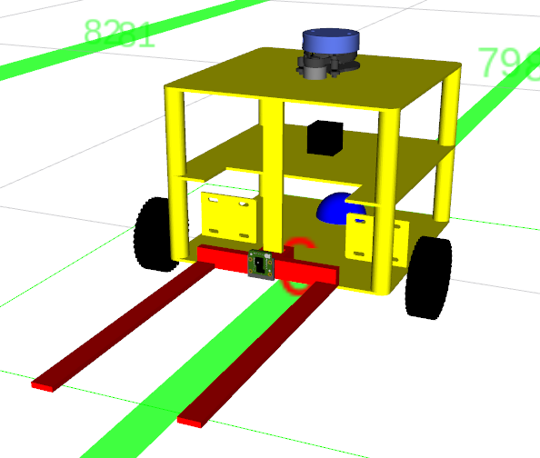
  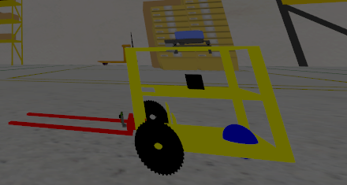
  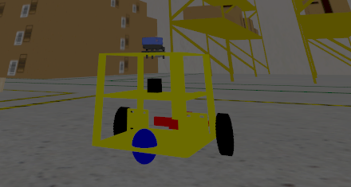
</p>

<p align="center">
  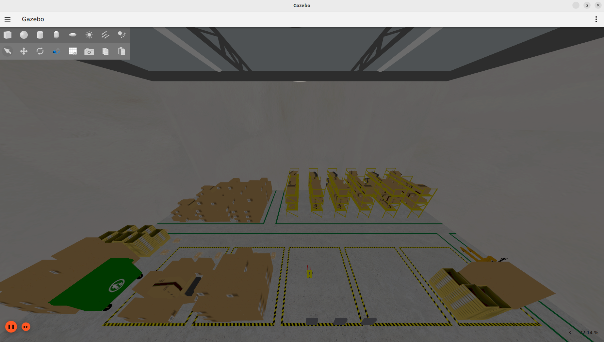
</p>

---

## Table of Contents
- [System Architecture](#system-architecture)
  - [1. Robot Hardware & Sensors](#1-robot-hardware--sensors)
  - [2. TF, Odometry & Localization](#2-tf-odometry--localization)
  - [3. Costmap System](#3-costmap-system)
  - [4. BT Navigation Executive](#4-bt-navigation-executive)
  - [5. Nav2 Servers (Modular ROS 2 Lifecycle Servers)](#5-nav2-servers-modular-ros-2-lifecycle-servers)
  - [6. Execution Feedback Loop](#6-execution-feedback-loop)
  - [7. Lifecycle Manager](#7-lifecycle-manager)
- [Packages](#packages)
- [Installation](#installation)
- [Usage](#usage)
- [Gallery](#gallery)
- [License](#license)

---

## System Architecture

<p align="center">
  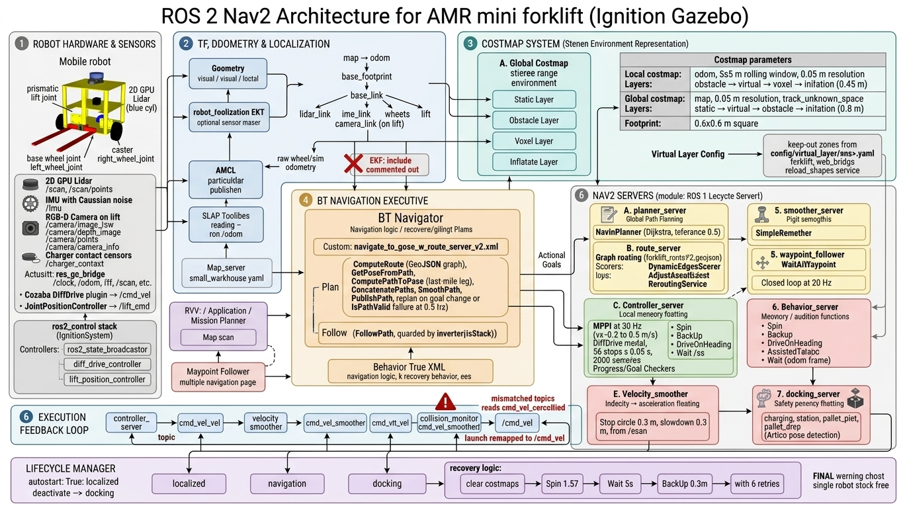
</p>

### 1. Robot Hardware & Sensors

The robot is a differential-drive forklift. Its URDF/xacro model lives in `forklift_description`, and it is simulated in Gazebo Fortress.

| Component | Frame | ROS topic(s) | Purpose |
|---|---|---|---|
| Differential drive (left/right wheel + caster) | `base_footprint` | `/cmd_vel`, `/odom` | Motion |
| Prismatic lift (`lift_joint`, 0 – 1.2 m) | `lift_link` | `/lift_cmd`, `/joint_states` | Pallet handling |
| 2D GPU lidar | `lidar_link` | `/scan`, `/scan/points` | Localization, costmaps, collision monitor |
| IMU (Gaussian noise) | `imu_link` | `/imu` | Odometry fusion (EKF) |
| RGB-D camera (on the lift) | `camera_link` | `/camera/image_raw`, `/camera/depth_image`, `/camera/points`, `/camera/camera_info` | ArUco docking, pallet detection |
| Charger contact sensor | — | `/charger_contact` | Charging dock confirmation |

- **Simulation bridge:** `ros_gz_bridge` (`forklift_gazebo/config/bridge_config.yaml`) carries the clock, odometry, TF, lidar, camera, `cmd_vel` and lift topics.
- **ros2_control:** the `ForkliftSystem` (`ign_ros2_control/IgnitionSystem`) runs `joint_state_broadcaster`, `diff_drive_controller` and `lift_position_controller`.
- **Lift stack (`forklift_controller`):** separate controller, driver, feedback, limit and safety nodes. The driver can talk to real hardware over serial (`/dev/ttyUSB0`, `use_hardware: false` in sim).

### 2. TF, Odometry & Localization

```
map ──(AMCL)──▶ odom ──(diff-drive odometry)──▶ base_footprint ──▶ base_link
                                                                    ├── lidar_link
                                                                    ├── imu_link
                                                                    ├── left/right_wheel, caster
                                                                    └── lift_link ── camera_link
```

| Transform / source | Provided by |
|---|---|
| `map → odom` | `nav2_amcl` (likelihood-field model, `DifferentialMotionModel`, 500–2000 particles on `/scan`) |
| `odom → base_footprint` + `/odom` | Gazebo DiffDrive / OdometryPublisher plugin |
| Robot links | `robot_state_publisher` from the URDF |
| Static map | `nav2_map_server` → `small_warehouse.yaml` |
| Mapping | `slam_toolbox` online async (`mapping_launch.py`) |
| Odometry fusion (optional) | `robot_localization` EKF (`forklift_localization/config/ekf.yaml`) fuses `/odom` and `/imu`. It is disabled by default (its include is commented out in the launch files) |

<p align="center">
  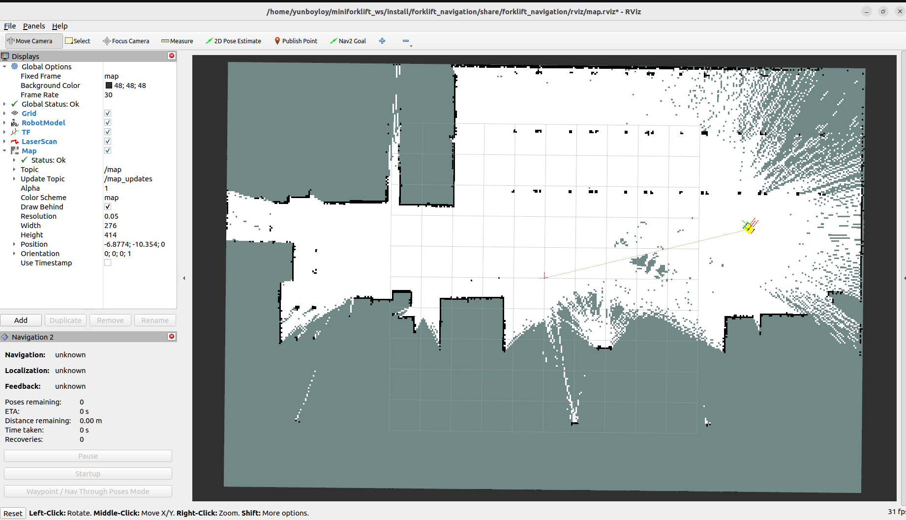
</p>

### 3. Costmap System

Both costmaps use a 0.6 × 0.6 m footprint and a 0.05 m resolution.

| | Local costmap | Global costmap |
|---|---|---|
| Global frame | `odom` (5 × 5 m rolling window) | `map` (tracks unknown space) |
| Layers (in order) | obstacle → **virtual** → voxel → inflation (0.45 m) | static → **virtual** → obstacle → inflation (0.8 m) |
| Sensor input | `/scan` | `/scan` + `/map` |

**Virtual layer (`nav2-virtual-layer`):** this custom costmap plugin, `nav2_virtual_layer::VirtualLayer`, adds virtual walls and keep-out zones. They are read from `forklift_navigation/config/virtual_layer/<robot>.yaml`. The dashboard edits them through `forklift_web_bridge`, which rewrites the file and calls the `reload_shapes` service so changes apply at runtime without a restart.

### 4. BT Navigation Executive

`bt_navigator` runs the `NavigateToPose` and `NavigateThroughPoses` navigators. It loads the standard Nav2 BT plugins plus two custom ones (`forklift_navigation/src/`):
- **`ConcatenatePaths`** joins two `nav_msgs/Path` segments.
- **`PublishPath`** republishes the combined path on `/plan` so RViz can display it.

The route-graph tree (`config/behavior_trees/navigate_to_pose_w_route_server_v2.xml`) works like this:

```
RecoveryNode (6 retries)
├── PipelineSequence
│   ├── ComputeRoute  (replan only when goal updated or path invalid, 0.5 Hz)
│   │     ComputeRoute (graph) → GetPoseFromPath → ComputePathToPose (last mile)
│   │     → ConcatenatePaths → SmoothPath → PublishPath
│   │     recovery: clear global + local costmaps
│   └── FollowPath  (guarded by Inverter(IsStuck))
│         recovery: clear local + global costmaps
└── Recovery RoundRobin: ClearCostmaps → Spin 1.57 → Wait 5 s → BackUp 0.3 m
```

> **Note:** the multi-robot params (`nav2_multirobot_params.yaml`) use this tree. Single-robot `nav2_params.yaml` currently uses Nav2's default `navigate_to_pose_w_replanning_and_recovery.xml`. To use the route tree there, uncomment `default_nav_to_pose_bt_xml`.

<p align="center">
  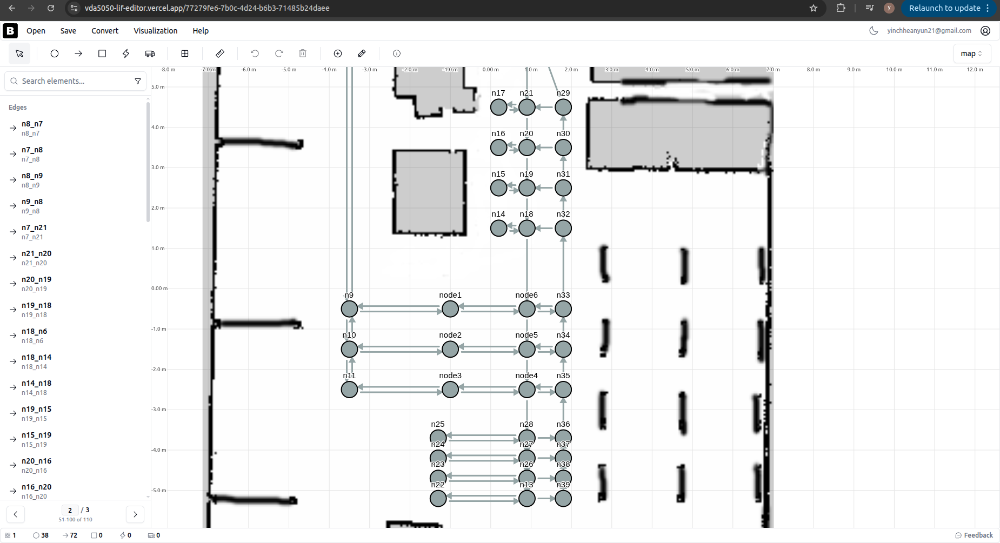
  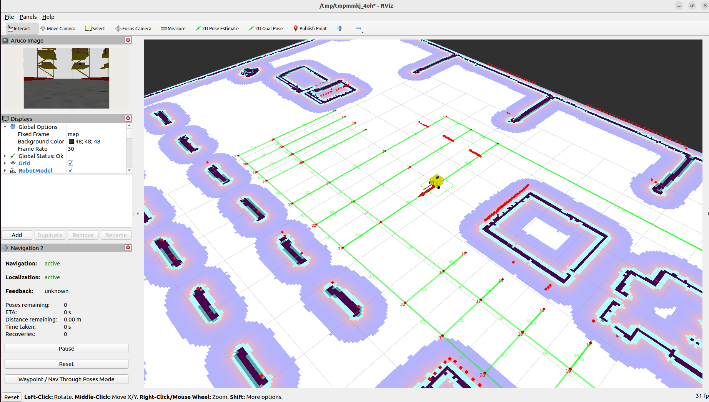
</p>

### 5. Nav2 Servers (Modular ROS 2 Lifecycle Servers)

| Server | Plugin / configuration |
|---|---|
| `planner_server` | `nav2_navfn_planner/NavfnPlanner` (tolerance 0.5 m) |
| `route_server` | Graph routing on `config/routes/forklift_routeV2.geojson`. Scorers: `DistanceScorer`, `DynamicEdgesScorer`. Operations: `AdjustSpeedLimit`, `ReroutingService` |
| `controller_server` | **MPPI** (default, 30 Hz, `DiffDrive`, 56 steps × 0.05 s, 2000 samples, vx −0.2 – 0.6 m/s). **Regulated Pure Pursuit** and **DWB** are also available (`controller_<type>.yaml`). Uses a SimpleProgressChecker and a stateful SimpleGoalChecker (0.2 m / 0.2 rad) |
| `smoother_server` | `nav2_smoother::SimpleSmoother` |
| `behavior_server` | Spin, BackUp, DriveOnHeading, AssistedTeleop, Wait |
| `waypoint_follower` | `WaitAtWaypoint` |
| `velocity_smoother` | Closed-loop, 20 Hz |
| `collision_monitor` | Stop circle 0.3 m, slowdown circle 0.9 m (× 0.55), from `/scan` |
| `docking_server` | `opennav_docking` with 4 dock types (`charging_dock`, `station_dock`, `pallet_pick_dock`, `pallet_drop_dock`). Dock poses come from ArUco detection |

### 6. Execution Feedback Loop

```
Web dashboard / MQTT ──▶ forklift_web_bridge
        │
        ▼
forklift_mission_manager (ExecuteMission) ──▶ forklift_task_manager (ExecuteTask)
        │                                      ├── NavigateToPose ──▶ bt_navigator
        │                                      ├── DockRobot / UndockRobot ──▶ docking_server
        │                                      └── SetLiftHeight ──▶ forklift_controller
        ▼
bt_navigator ──▶ route_server / planner_server ──▶ smoother_server ──▶ path
        ▼
controller_server (MPPI + local costmap + /odom + TF) ──▶ cmd_vel_nav
        ▼
velocity_smoother ──▶ collision_monitor ──▶ /cmd_vel ──▶ robot (Gazebo / hardware)
        ▼
/odom, /tf, /scan, /imu ──▶ AMCL + costmaps ──▶ back to controller & BT
```

The progress checker, goal checker and BT conditions (`IsStuck`, `IsPathValid`, `GoalUpdated`) close the loop by triggering replanning or recovery. Action feedback and results go up to the task and mission managers and on to the dashboard. `forklift_traffic_manager` handles edge reservation (`ReserveEdge.srv`) between robots, and `forklift_safety` and `forklift_diagnostics` report robot health.

### 7. Lifecycle Manager

Each group of Nav2 nodes is managed by an `nav2_lifecycle_manager` instance with `autostart: true`. The manager steps every node through *configure* and then *activate* in order, and uses bond heartbeats to bring the group down safely if a node crashes.

| Lifecycle manager | Managed nodes |
|---|---|
| `lifecycle_manager_localization` | `map_server`, `amcl` |
| `lifecycle_manager_navigation` | `controller_server`, `smoother_server`, `planner_server`, `behavior_server`, `bt_navigator`, `waypoint_follower`, `velocity_smoother`, `collision_monitor`, `route_server` |
| `lifecycle_manager_docking` | `docking_server` |

Nodes can run as separate processes or composed in a `component_container_isolated` (`use_composition:=true`). At the system level, `forklift_bringup` staggers the stages with `TimerAction` delays (navigation at 2 s, controller and ArUco at 10 s, task manager at 14 s, mission manager at 16 s).

---

## Packages

| Package | Description |
|---|---|
| `forklift_description` | URDF/xacro robot model (base, wheels, lift, sensors, ros2_control) |
| `forklift_gazebo` | Gazebo Fortress worlds, models, spawning and ROS–Gazebo bridge |
| `forklift_bringup` | One-command single- and multi-robot bringup |
| `forklift_localization` | EKF sensor fusion (robot_localization) |
| `forklift_navigation` | Nav2 config, maps, route graphs, behavior trees, custom BT nodes |
| `nav2-virtual-layer` | Costmap plugin for virtual walls and keep-out zones |
| `forklift_docking` | `opennav_docking` config and plugins for charging and pallet docks |
| `forklift_aruco` | ArUco marker pose estimation for docking |
| `pallet_vision` | Pallet detection with the depth camera |
| `forklift_controller` | Lift controller, driver, feedback, limits and safety |
| `forklift_safety` | Safety fields, speed zones, sensor monitoring |
| `forklift_diagnostics` | Hardware, sensor and maintenance diagnostics |
| `forklift_task_manager` | `ExecuteTask` action server (navigate → dock → lift workflows) |
| `forklift_mission_manager` | `ExecuteMission` action server (sequences of tasks) |
| `forklift_traffic_manager` | Multi-robot traffic and edge reservation |
| `forklift_web_bridge` | FastAPI / MQTT bridge to the web dashboard |
| `forklift_remote` | PS4 and keyboard teleoperation |
| `forklift_interfaces` | Custom messages, services and actions |

Each package has its own `README.md` with more detail.

---

## Installation

**Requirements:** Ubuntu 22.04, ROS 2 Humble, Gazebo Fortress, Nav2 (with `nav2_route` and `opennav_docking`).

```bash
mkdir -p ~/miniforklift_ws && cd ~/miniforklift_ws
git clone <this-repo-url> .
rosdep install --from-paths src --ignore-src -r -y
colcon build --symlink-install
source install/setup.bash
```

---

## Usage

```bash
# 1. Start the simulation (Gazebo + robot + bridge)
ros2 launch forklift_gazebo forklift_ign_gazebo.launch.py

# 2. Start navigation, docking, controller, ArUco, task and mission managers
ros2 launch forklift_bringup single_robot_bringup.launch.py
```

Other entry points:

```bash
# Mapping with slam_toolbox
ros2 launch forklift_navigation mapping_launch.py

# Navigation only, with a specific controller (mppi | pure_pursuit | dwb)
ros2 launch forklift_navigation bringup_launch.py controller_type:=mppi

# Multi-robot
ros2 launch forklift_bringup multiple_robot_world.launch.py
ros2 launch forklift_bringup multiple_bringup_launch.py

# Web dashboard bridge
ros2 launch forklift_web_bridge forklift_web_bridge.launch.py

# Teleoperation
ros2 launch forklift_remote ps4_teleop.launch.py
ros2 run forklift_remote keyboard_control_node
```

---

## Gallery

| ArUco marker detection | Pallet detection (depth camera) |
|---|---|
| 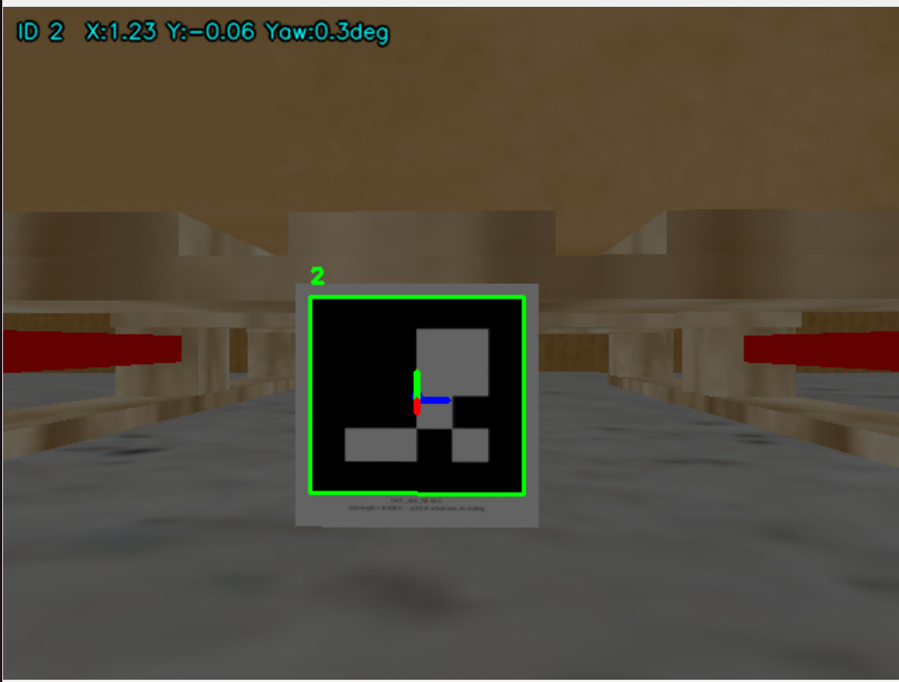 | 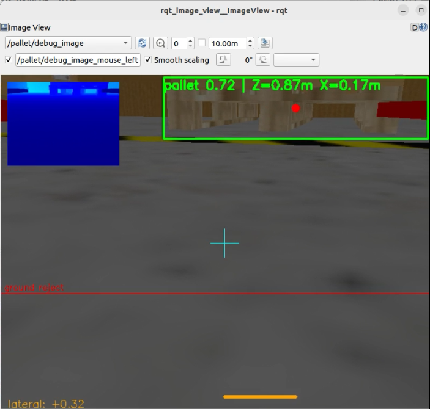 |

| Charging station | Pallet in Gazebo |
|---|---|
| 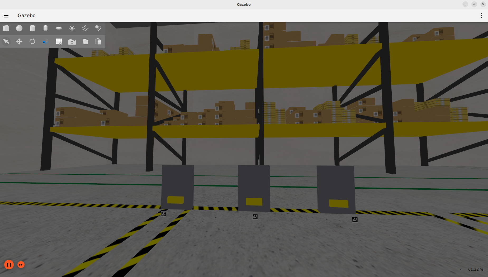 | 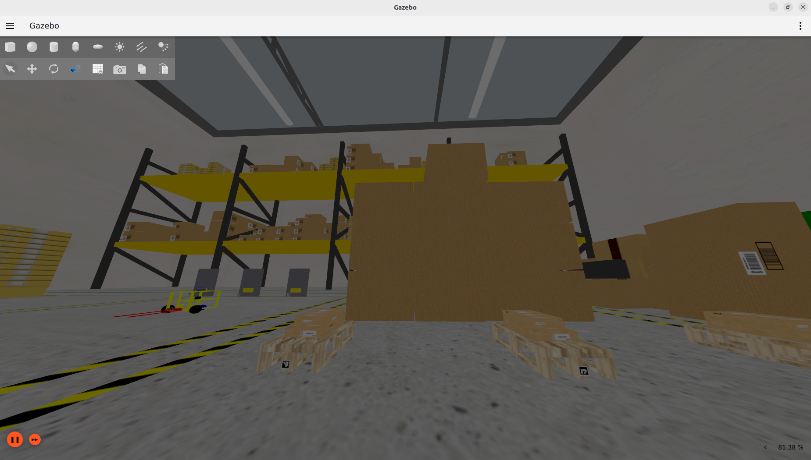 |

---

## License

Apache License 2.0. See the `LICENSE` file in each package.
